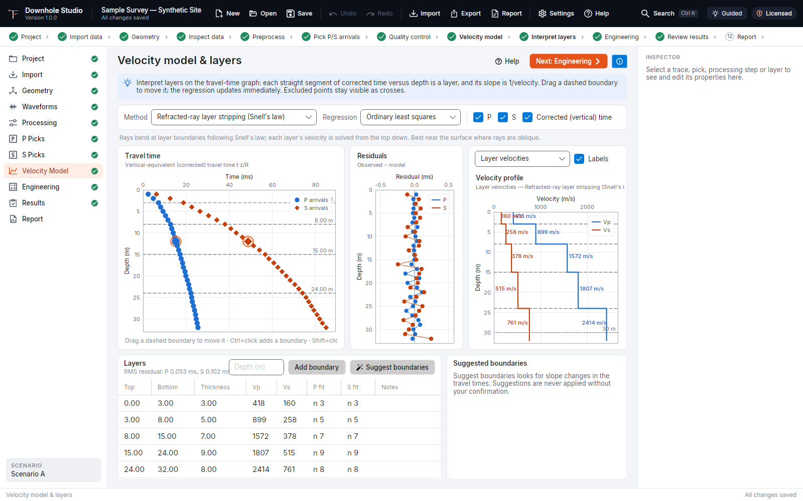
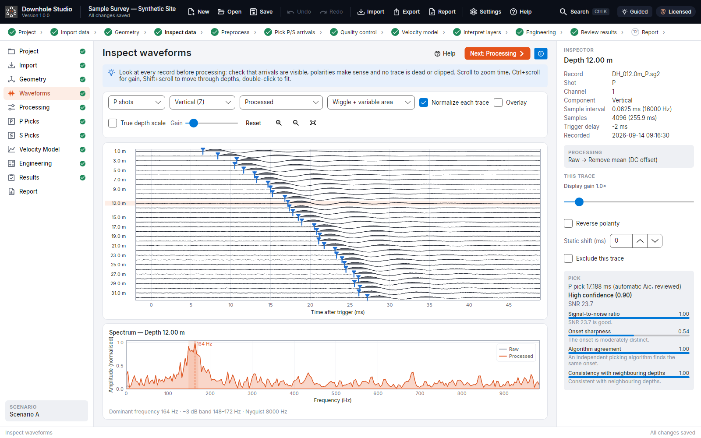
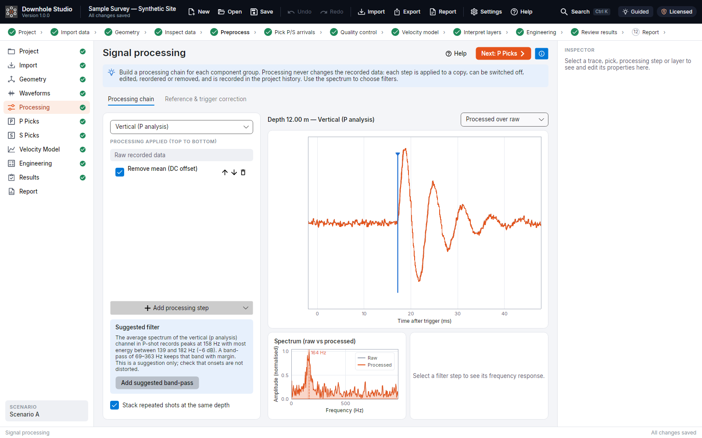
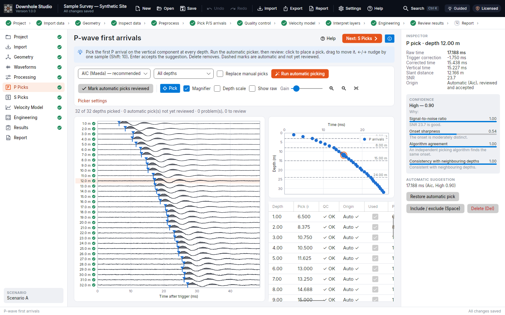
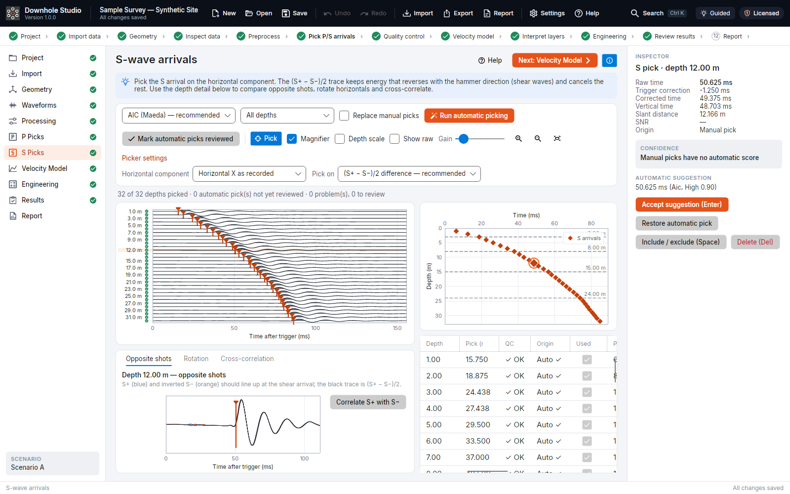
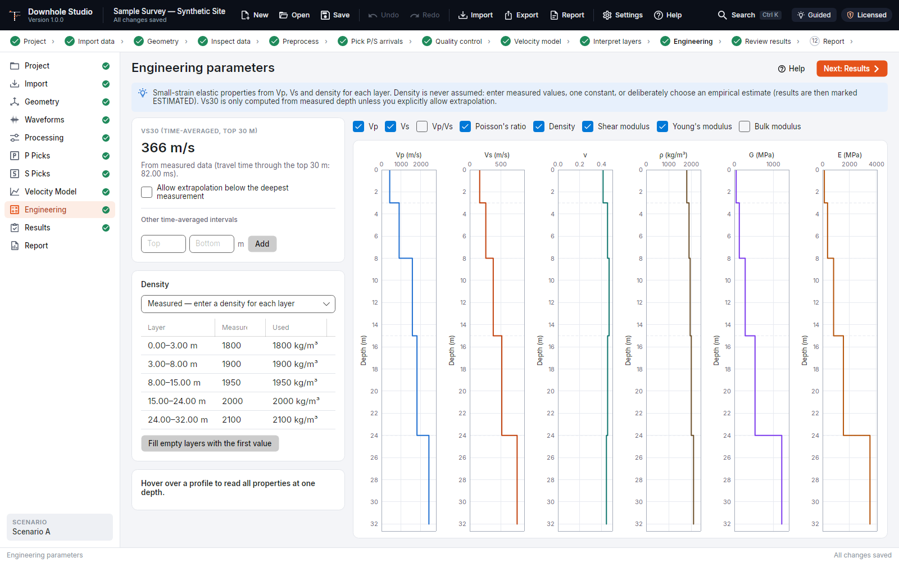
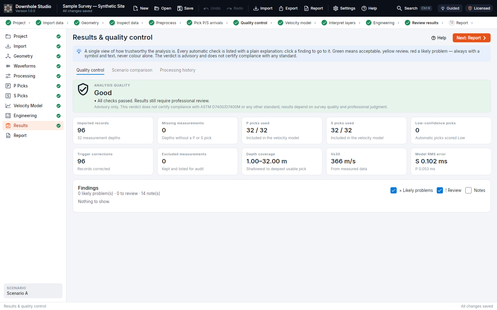
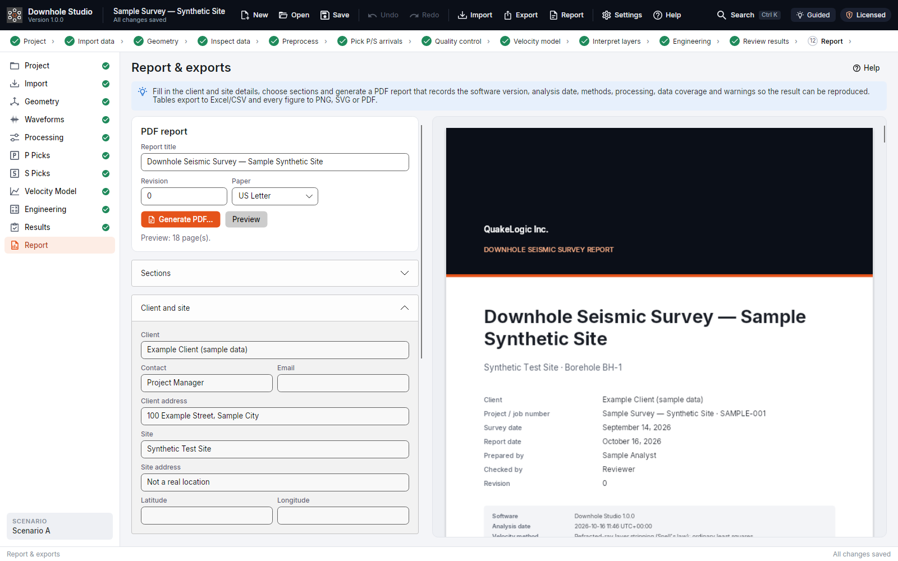

<p align="center">
  
</p>

<h1 align="center">QuakeLogic Downhole Studio</h1>

<p align="center"><strong>Downhole seismic processing, interpretation, quality control and reporting.</strong><br>
From raw SEG-2 records to reviewed P and S picks, a validated velocity model, Vs30 and a professional report — in one Windows application.</p>

<p align="center">
  <a href="https://github.com/omerozgul11/ql-downhole/raw/main/download/DownholeStudio-Setup.exe"></a>
</p>

<p align="center">Windows 10 (21H2 or later) or Windows 11, 64-bit · 14-day free trial · no administrator rights needed</p>

<p align="center"></p>

---

## What it is

Downhole Studio is a desktop application for **downhole seismic testing**: P and S waves are generated at the surface next to a borehole and recorded by a geophone at successive depths. It takes the field records to a defensible, fully documented result:

- import with validation **before** anything is accepted, and survey geometry with a live borehole diagram;
- transparent, non-destructive processing and trigger correction;
- automatic P and S picking with a confidence score that explains itself, and fast manual review;
- layer interpretation with four velocity methods, including Snell's-law refracted-ray layer stripping;
- engineering parameters (Poisson's ratio, shear, Young's and bulk moduli) and Vs30;
- quality control in plain language, and a branded PDF report with the full processing history.

It is built for geotechnical and geophysical engineers who need results they can explain. Raw records are never modified. Every processing step, pick and exclusion is recorded. Density is never assumed, and Vs30 is never extrapolated unless you allow it, in which case it is labelled as such everywhere.

## Highlights

| | |
|---|---|
| **Validated import** | SEG-2 by drag-and-drop, files or folders. Every file is inspected before import: sample rates, missing channels, duplicates, depth sequence and acquisition order are reported as errors, warnings or information. Nothing is repaired silently. Originals are kept byte-for-byte with SHA-256 checksums. |
| **Geometry you can see** | Independent P and S source offsets, depth assignment by acquisition order or from the files, reusable channel profiles, and a borehole diagram drawn to scale. |
| **Non-destructive processing** | Mean/trend removal, taper, Butterworth filters (causal or zero-phase), notch, AGC, balance, polarity, static shifts and resampling, each with its own on/off switch. Spectra and filter responses sit alongside. |
| **Picking with reasons** | AIC, STA/LTA and modified-energy-ratio pickers. Every automatic pick has a confidence score built from SNR, onset sharpness, agreement between algorithms and consistency with neighbouring depths. Manual picking is keyboard-friendly, with a magnifier and snap-to-suggestion. |
| **Shear waves done properly** | Opposite-direction shots, (S⁺ − S⁻)/2 difference traces, stacking, polarization analysis with hodogram and per-depth rotation, and cross-correlation between opposite shots and adjacent depths. |
| **Trigger correction** | Reference (spy) geophone onsets picked automatically. The correction either subtracts the onset or aligns to the median. Raw and corrected times are always both kept. |
| **Velocity model** | Interactive travel-time graphs with draggable boundaries. Layer regression (least squares or robust Huber), pseudo-interval, true-interval and refracted-ray layer stripping. Boundary suggestions are made with a BIC penalty and require a minimum velocity contrast. |
| **Engineering & Vs30** | Vp/Vs, ν, G, E and K from measured, constant or explicitly estimated density (estimates labelled ESTIMATED). Vs30 and custom time-averaged intervals. |
| **Quality control** | Automatic checks with plain-language explanations, a *Good / Review recommended / Incomplete* verdict, and scenario comparison. |
| **Reports & exports** | Branded PDF report with methodology, QC, figures, tables and processing history. Excel and CSV tables at full precision. PNG, SVG and PDF figures. An audit record for every project. |
| **Safe by design** | Application-wide undo/redo, snapshots and scenarios. Atomic saves with a backup copy, and automatic recovery copies. Survey data never leaves your computer. |

## A tour of the application

The screenshots below are taken from the **sample project** that ships with the installer: a complete synthetic survey with 32 depths, opposite-direction S shots and a reference geophone. Open it from the start screen with **Explore Sample Project**.

### Waveforms
Every trace at every depth, raw or processed, as wiggle or variable area, with picks overlaid. Hover for depth, channel, amplitude, SNR and QC status. The spectrum of the selected trace is shown raw versus processed.

<p align="center"></p>

### Processing
Each component (vertical, horizontal, reference) has its own processing chain. Steps apply to a copy of the data and can be switched off, edited, reordered or removed. Filter suggestions are computed from the spectrum of the shots each chain is used for, and are applied only when you choose.

<p align="center"></p>

### P and S picking
Run the automatic picker, then review each depth. The inspector explains the confidence of each pick. For S waves, the depth detail overlays S⁺ and inverted S⁻ so you can confirm the shear arrival before accepting it.

<p align="center"></p>
<p align="center"></p>

### Velocity model
Add, drag, merge or suggest layer boundaries on the travel-time graph. The velocities, residuals and profile update immediately (screenshot at the top of this page).

### Engineering parameters and Vs30
Profiles of Vp, Vs, Poisson's ratio, density and moduli, with Vs30 computed from measured data only.

<p align="center"></p>

### Quality control
A single view of how trustworthy the analysis is, with every finding linked to the depth, record or layer concerned.

<p align="center"></p>

### Report
Fill in the client, site and branding details, choose the sections, preview the report page by page and generate the PDF.

<p align="center"></p>

## Download and install

1. Download the installer with the **Download for Windows** button at the top of this page, or open the [`download`](download/) folder and click `DownholeStudio-Setup.exe`. It is always the latest version.
2. Run `DownholeStudio-Setup.exe`. By default it installs for the current user, so no administrator rights are needed. Its SHA-256 checksum is in [`download/DownholeStudio-Setup.exe.sha256`](download/DownholeStudio-Setup.exe.sha256).
3. If Windows SmartScreen shows *Windows protected your PC*, choose **More info → Run anyway**. This appears for builds that are not code-signed; see [Code signing](DEPLOYMENT.md#code-signing).
4. Start **Downhole Studio** from the Start menu. Click **Start 14-Day Free Trial** or **Activate License**, then **Explore Sample Project**.

**System requirements:** 64-bit Windows 10 (21H2 or later; 22H2 recommended) or Windows 11; 8 GB RAM recommended; about 200 MB of disk space plus room for projects; an internet connection to start the trial or activate (not needed for daily work).

Updates are offered inside the application (Settings → Updates). They are cryptographically signed and verified before they install. Uninstalling never removes your projects or settings.

## Licensing

- **Free trial:** every computer can use a 14-day trial. It starts when you click *Start trial* and does not restart after reinstalling.
- **Per-computer licences:** activate with the e-mail address and licence key you received. Paid licences work **offline for 30 days** between online checks. To move a licence, deactivate it in Settings → License and activate it on the new computer.
- **Never locked out of your data:** without an active licence, projects still open read-only. A licence problem never modifies or deletes a project.
- **Privacy:** licensing sends only a salted hash of hardware identifiers, the application and Windows versions and, if you allow it, the computer name. There is no usage telemetry.

To buy a licence, visit [quakelogic.net/downhole-studio](https://quakelogic.net/downhole-studio) or [contact QuakeLogic](https://quakelogic.net/contact).

## Supported data

| | |
|---|---|
| **Input** | SEG-2 revision 1, either byte order, with 16- or 32-bit integer or 32/64-bit floating-point samples. The 20-bit packed format is reported as unsupported rather than decoded by guesswork. See [SEG2-PARSER.md](SEG2-PARSER.md). |
| **Projects** | `.dhsx`: a single versioned file holding the original records, decoded samples, interpretation and history. See [docs/file-formats/dhsx.md](docs/file-formats/dhsx.md). |
| **Output** | PDF reports; Excel (`.xlsx`) and CSV tables; PNG, SVG and PDF figures; JSON audit records. |

## Scientific method

Travel times are corrected for trigger delay using the reference geophone. They are then reduced to vertical-equivalent times with straight-ray geometry (t·z/R), or modelled directly with refracted rays obeying Snell's law. Layer velocities come from least-squares or robust (Huber) regression within each layer, or from top-down layer stripping. Interval velocities are reported with their straight-ray assumption stated. Signal processing is verified against SciPy reference values. The full pipeline is validated on synthetic surveys with a known answer, timed by an independent ray tracer: all 87 checks pass, and Vs30 is recovered within 0.2–1.2 %. Details are in [SCIENTIFIC-VALIDATION.md](SCIENTIFIC-VALIDATION.md), the [validation report](docs/validation/validation-report.md), and [docs/algorithms](docs/algorithms/README.md), which gives the equations, assumptions and limitations.

**Standards and responsibility.** Downhole Studio supports the established downhole workflow described in ASTM D7400/D7400M. It does not certify compliance with that or any other standard. Results depend on survey quality and require professional review.

## Documentation

| | |
|---|---|
| [User guide](docs/USER-GUIDE.md) | Every page of the application, shortcuts and troubleshooting. Also built into the app: press **F1**. |
| [Algorithms](docs/algorithms/README.md) | Equations, assumptions and limitations of every method. |
| [Scientific validation](SCIENTIFIC-VALIDATION.md) | How results are verified, and the latest report. |
| [Reporting](REPORTING.md) | Report contents and export formats. |
| [Security](SECURITY.md) | How data, licences and updates are protected. |

## Support

Contact QuakeLogic at [quakelogic.net/contact](https://quakelogic.net/contact). Attach the diagnostic package (Settings → Diagnostics → *Export diagnostic package…*). It contains logs with personal details redacted, and includes no project data unless you add it.

---

## For developers

Downhole Studio is written in C# on .NET 10 with Avalonia 12 (MVVM) and SkiaSharp. The licence server and admin portal use ASP.NET Core and PostgreSQL.

```bash
scripts/setup-dev.sh                 # installs the pinned .NET SDK into .tools/
source .tools/env.sh
dotnet test DownholeStudio.sln       # unit, UI and PostgreSQL integration tests (Docker)
scripts/build.sh                     # tests, validation, publish and the Windows installer (Docker)
```

**Secrets never go in the repository.**
- Local build, signing and release settings live in `.env`; copy [`.env.example`](.env.example) to start.
- Licence-server secrets live in `server/.env`; copy [`server/.env.example`](server/.env.example) to start.
- Both `.env` files are git-ignored, and so are all private keys (`*.pem`, `*.pfx`).
- Only the *public* licence and update keys are compiled into the application.

| Document | Contents |
|---|---|
| [ARCHITECTURE.md](ARCHITECTURE.md) | Layers, data model, editing model, persistence, licensing |
| [BUILD.md](BUILD.md) | Building, testing and packaging |
| [DEPLOYMENT.md](DEPLOYMENT.md) | Releases, code signing, update feed |
| [LICENSE-SERVER.md](LICENSE-SERVER.md) | Licence server and admin portal |
| [TESTING.md](TESTING.md) | Test suites |
| [docs/architecture](docs/architecture/README.md) · [docs/file-formats](docs/file-formats/README.md) · [docs/licensing](docs/licensing/README.md) | Design notes |

Copyright © 2026 QuakeLogic Inc. All rights reserved. Downhole Studio is commercial software, licensed under the [end-user licence agreement](packaging/windows/EULA.txt). Third-party components are listed in [THIRD_PARTY_NOTICES.txt](THIRD_PARTY_NOTICES.txt).
