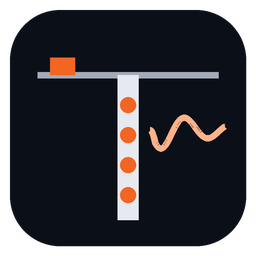

  

<h1 align="center">Downhole Studio</h1>

<strong>Downhole seismic processing, interpretation, quality control and reporting — by QuakeLogic.</strong> 
From raw SEG-2 records to reviewed P/S picks, a validated velocity model and a professional report, in one application.

  <a href="https://github.com/__REPOSITORY__/releases/latest/download/DownholeStudio-Setup.exe"><strong>⬇ Download Downhole Studio for Windows</strong></a>

Windows 10 (22H2) or Windows 11, 64-bit · 14-day free trial · no administrator rights needed

---

## Install

1. Download the installer with the link above and run it.
2. If Windows SmartScreen shows "Windows protected your PC", choose **More info → Run anyway** (see *Code signing* below).
3. Start **Downhole Studio** from the Start menu, click **Start 14-Day Free Trial** or **Activate License**, then **Explore Sample Project** to see a complete worked survey.

Projects are stored wherever you save them (by default `Documents\Downhole Studio`). Uninstalling never deletes projects or settings.

## What it does

| | |
|---|---|
| **Import** | SEG-2 (16/32-bit integer and 32/64-bit float, either byte order) by drag-and-drop, files or folders. Every file is inspected and validated *before* import: sample rates, record lengths, missing traces and channels, duplicates, depth sequence and acquisition order are reported as errors, warnings or information. Nothing is repaired silently; corrections are applied only when you approve them. Originals are embedded byte-for-byte with SHA-256 checksums. |
| **Geometry** | Borehole, collar and independent P and S source geometry; depth assignment by acquisition order (top-down or bottom-up), from file suggestions, or by hand; channel mapping with reusable instrument profiles; live borehole diagram. |
| **Processing** | Non-destructive chains per component: mean/trend removal, taper, Butterworth high/low/band-pass (causal or zero-phase, any order), notch, normalisation, balance, AGC, polarity, time shift and anti-aliased resampling. Enable, edit, reorder or remove any step; raw and processed data are always distinguishable; spectra and filter responses alongside. |
| **Picking** | AIC, STA/LTA and modified-energy-ratio pickers with a confidence score that explains itself (SNR, onset sharpness, algorithm agreement, neighbour consistency, opposite-polarity agreement). Fast manual picking with drag, keyboard nudging, magnifier and snap-to-suggestion. |
| **S waves** | Opposite-direction shots, (S⁺ − S⁻)/2 difference traces, stacking, polarization analysis with hodogram and per-depth rotation (never applied silently), cross-correlation between opposite shots and adjacent depths. |
| **Trigger correction** | Reference (spy) geophone onsets picked automatically or by hand; subtract-onset or align-to-median corrections; raw and corrected times always kept. |
| **Velocity model** | Interactive travel-time graphs; layer regression (OLS or robust Huber), pseudo-interval, true-interval and Snell's-law refracted-ray layer stripping; draggable layer boundaries, suggested boundaries, residuals, profiles. |
| **Engineering** | Vp/Vs, Poisson's ratio, shear, Young's and bulk moduli with explicit density (measured, constant, or a labelled empirical estimate); Vs30 and custom time-averaged intervals — never extrapolated unless you allow it, and then labelled EXTRAPOLATED. |
| **Quality control** | Automatic checks with plain-language explanations, a Good / Review recommended / Incomplete verdict, and scenario comparison. |
| **Reports & exports** | Branded PDF report with methodology, QC, figures, tables, warnings and full processing history; Excel and CSV tables at full precision; PNG/SVG/PDF figures; clipboard. |
| **Auditability** | Application-wide undo/redo, snapshots, scenarios, an append-only processing history and an exportable audit record of files, processing, picks, exclusions, methods and software version. |

Downhole Studio supports the established downhole workflow (ASTM D7400/D7400M) but does not certify compliance with any standard. Results depend on survey quality and require professional review.

## Licensing

Per-computer licences with online activation and a 14-day trial. Paid licences work offline for 30 days between checks. A licence problem never blocks opening or viewing projects and never modifies them. See [docs/licensing](docs/licensing/README.md) and [LICENSE-SERVER.md](LICENSE-SERVER.md).

## Code signing

Release builds are designed to be Authenticode-signed (see [DEPLOYMENT.md](DEPLOYMENT.md)). Builds made without QuakeLogic's code-signing certificate are unsigned; the release notes state which applies.

## For developers

| Document | Contents |
|---|---|
| [ARCHITECTURE.md](ARCHITECTURE.md) | Layers, data model, editing model, persistence, licensing |
| [BUILD.md](BUILD.md) | Building, testing and packaging |
| [DEPLOYMENT.md](DEPLOYMENT.md) | Releases, signing, update feed, licence server |
| [LICENSE-SERVER.md](LICENSE-SERVER.md) | Licence server and admin portal |
| [SCIENTIFIC-VALIDATION.md](SCIENTIFIC-VALIDATION.md) | How results are validated; [latest report](docs/validation/validation-report.md) |
| [SEG2-PARSER.md](SEG2-PARSER.md) | SEG-2 reader behaviour |
| [REPORTING.md](REPORTING.md) | Report and export design |
| [SECURITY.md](SECURITY.md) | Security model |
| [TESTING.md](TESTING.md) | Test suites |
| [docs/USER-GUIDE.md](docs/USER-GUIDE.md) | User guide |
| [docs/algorithms](docs/algorithms/README.md) | Equations, assumptions and limitations |

Copyright © 2026 QuakeLogic Inc. All rights reserved. Third-party components: [THIRD_PARTY_NOTICES.txt](THIRD_PARTY_NOTICES.txt).
